# How to Archive Your Computer!

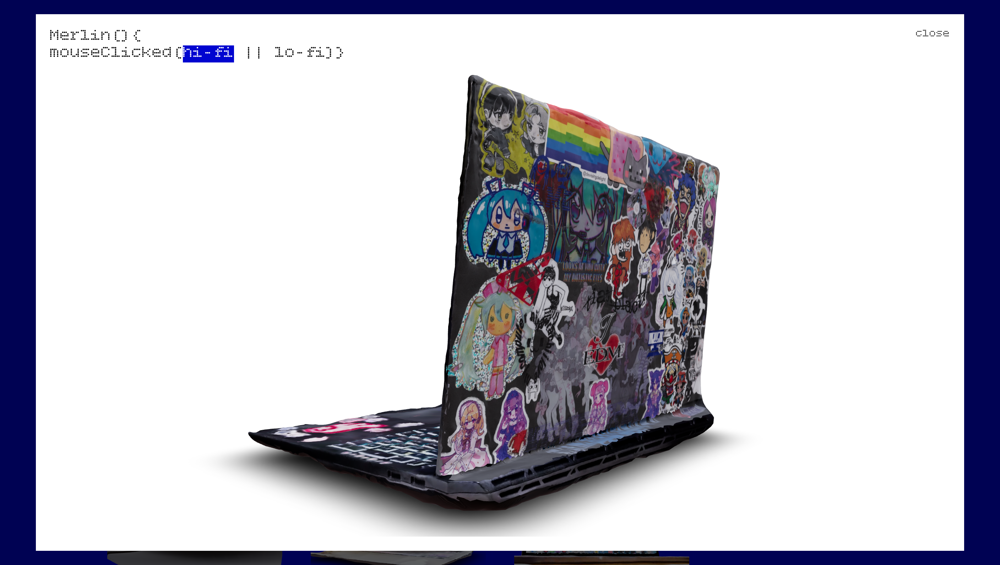

A tutorial on how to archive your own computer so it can be part of computers.json :-)

Everything is completely free and can be DIYed! It is okay if it is janky! It is made by humans! Let's use what we have access to--no fancy, expensive equipment required! :-)

## Tools/Software Needed

- Polycam (Free version is OK!)
- Your phone!
- Flatbed photo scanner (Find one at your local library/makerspace!)
- Blender (Free!)
- MeshLab (Free!)

## Tips

- Have a GOOD file system!
- Make sure to LABEL properly!

File Setup Example:

```
--- {name}_computer_archive (folder)
        |
        --- polycam_EXPORT (folder)
            |
            --- textures (folder)
            --- {name}.mtl
            --- {name}.obj
        --- meshlab_EXPORT (folder)
            |
            --- {name}_computer_fixedmesh.mlp
            --- {name}_computer_fixedmesh.obj
        --- flatbedScans_EXPORT (folder)
            |
            --- {name}_desktopScreenshot.png
            --- {name}_keyboardSurface_Scan.jpeg
            --- {name}_topSurface_Scan.jpeg
            --- {name}_bottomSurface_Scan.jpeg
        --- blender_file (folder)
            |
            --- {name}_computer_fixedmesh.obj
            --- {name}_computer.blend
            --- textures_UPDATED (folder)
                |
                --- (COPY flatbedScans_EXPORT folder HERE)
            --- textures_POLYCAM (folder)
```

## Step 1: Open Polycam

- Place your laptop on a flat surface, ideally with good lighting.
- Open Polycam on your phone and use either auto or manual mode to take pictures of your device (via photogrammetry). I recommend checking out [this video made by Polycam](https://www.youtube.com/watch?v=IXMCAvocxXc) for further help :)

- After capturing, Polycam will ask you to process your photos. These are the settings to choose:

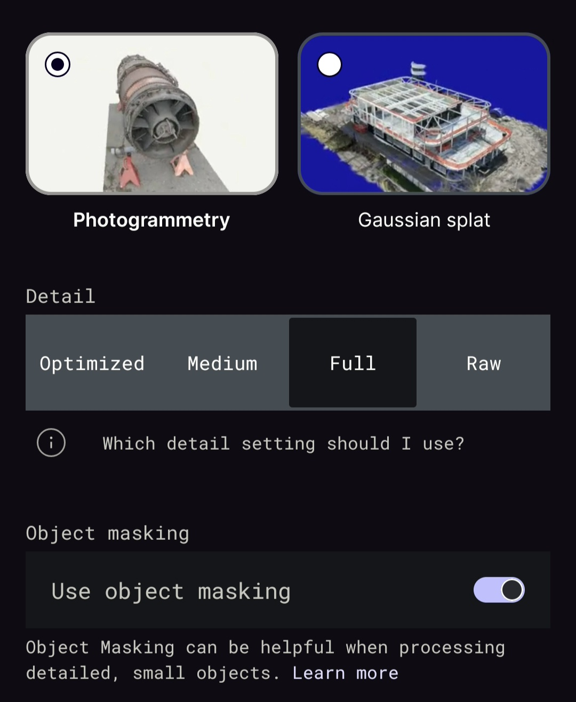

- I highly recommend cropping + doing small edits in the Polycam settings!

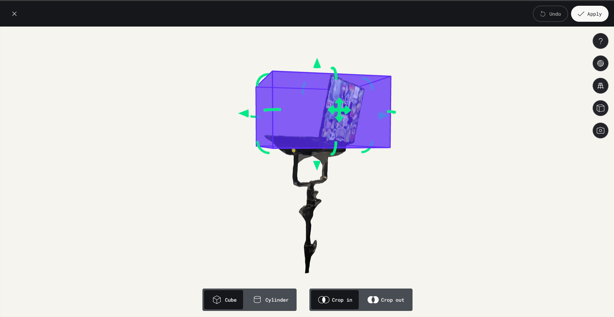

- Export your model as an OBJ file!

## Step 2: Scan the Surfaces (via Flatbed Scanner)

_Why? We want high-quality scans because photogrammetry will not capture the fine, tiny details. Using a flatbed scanner to capture the surfaces will allow us to create high-resolution 3D 'captures'._

Settings (the ones I used, may differ between scanners!):

- 600 DPI (300 DPI minimum)
- JPEG output (TIFF/PNG is OK! No PDF)
- Scanned at tabloid size (landscape)

Surfaces to Scan:

- Top surface of laptop
- Bottom surface of laptop
- Inside of laptop (keyboard & screen) _(if possible)_

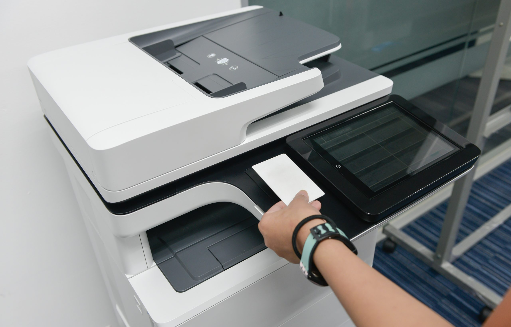

You can honestly just lay your laptop flat (CLOSED) and scan both sides. If your laptop can lie flat when it's open, I would also scan the inside of the laptop (keyboard + screen). Even if the screen is on, it won't show up in the scan, but we are just capturing the other details, so it's ok.

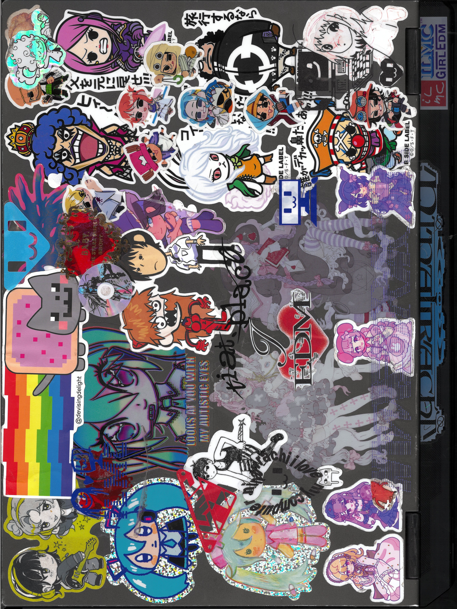

Once you're done scanning:

- Crop each scan so only the laptop surface is showing
- Rotate each scan so it's in the correct orientation
- Take a screenshot of your desktop (this will be used as the texture for your screen!)
- Save everything in your `flatbedScans_EXPORT` folder

- Also make sure to take a screenshot of your desktop!

## Step 3: Import 3D Model -> MeshLab

_Why? To make sure the mesh is optimized + fixed! We want our OBJ file to be as small as possible while still retaining as much detail as possible. So we use these tools to clean up any unnecessary vertices/planes that won't affect the overall final model._

- File -> Import Mesh -> open your model (OBJ) in MeshLab to clean up vertices/planes/holes
- Every model is different, but I recommend going through Filters -> Cleaning and Repairing

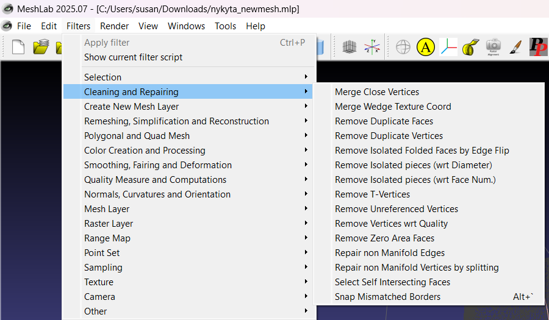

- Save your model:
  - File -> Export Mesh As -> OBJ (this is the cleaned-up model!)
  - File -> Save Project As -> MLP (optional, saves your MeshLab project)

## Step 4: Import New 3D Model -> Blender

**Step 4.1**

- Import OBJ file -> set origin to "Origin to Center of Mass (Volume)" -> scale size -> fix rotation so the model sits flat on the plane

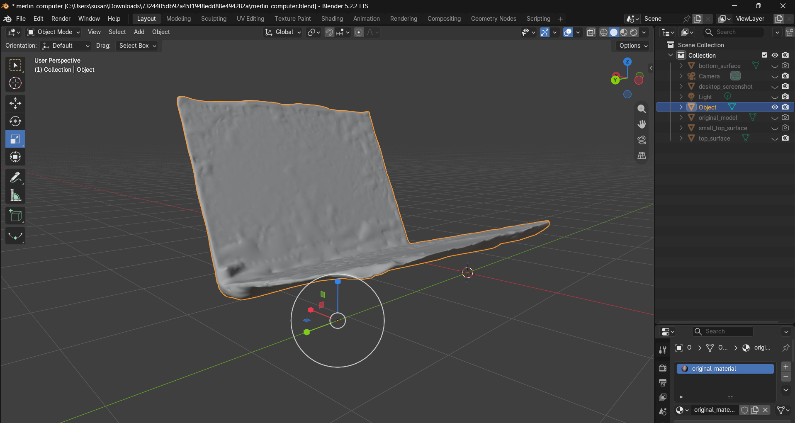

- Once it looks right, press Ctrl+A -> "Rotation & Scale" to apply your changes (this prevents weird issues when exporting later!)

**Step 4.2 - Fixing the Model in Blender (Double-Checking)**

_Why? I usually like to double-check + fix any remaining issues in the model to ensure it's optimized!_

- Go into Edit Mode -> Select Mode: FACE

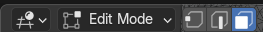

- Select All (A) -> under "Mesh" -> "Clean Up"
  These are the clean up options I would use:
  - Fill Holes
  - Merge by Distance
  - Delete Loose

**Step 4.3 - Separating Planes**

- Make sure the "Select Mode" is on faces

Select the panel/surface you are mapping the scan to.

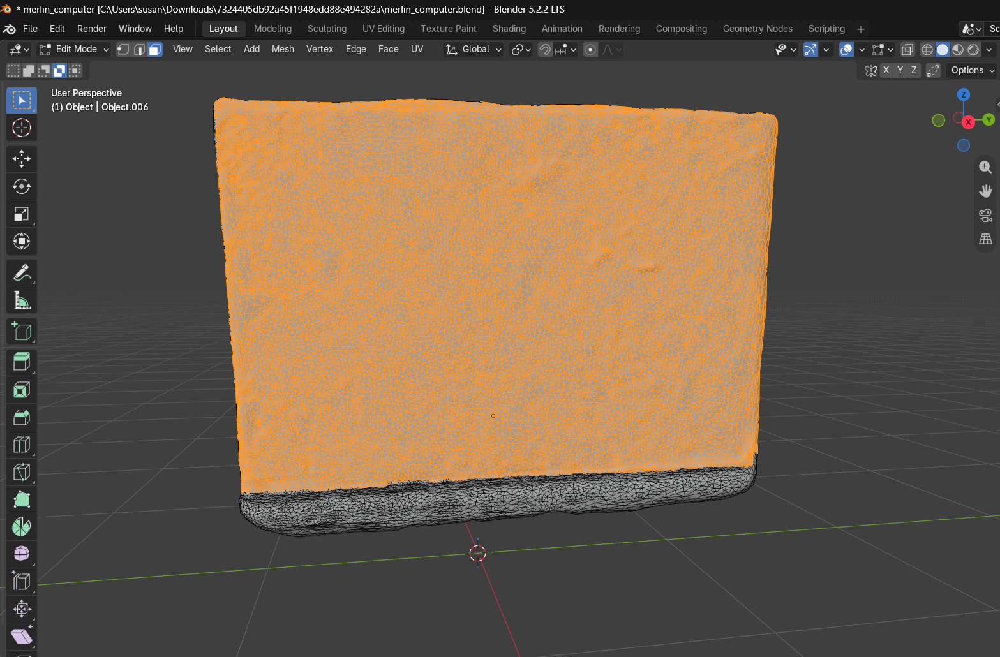

Once selected:
Click Mesh -> Separate -> Selection

This separates the model into panels, so you can add the flatbed scans onto them. This keeps everything separate and organized. Since we are adding multiple different scans as textures, we need to separate them.

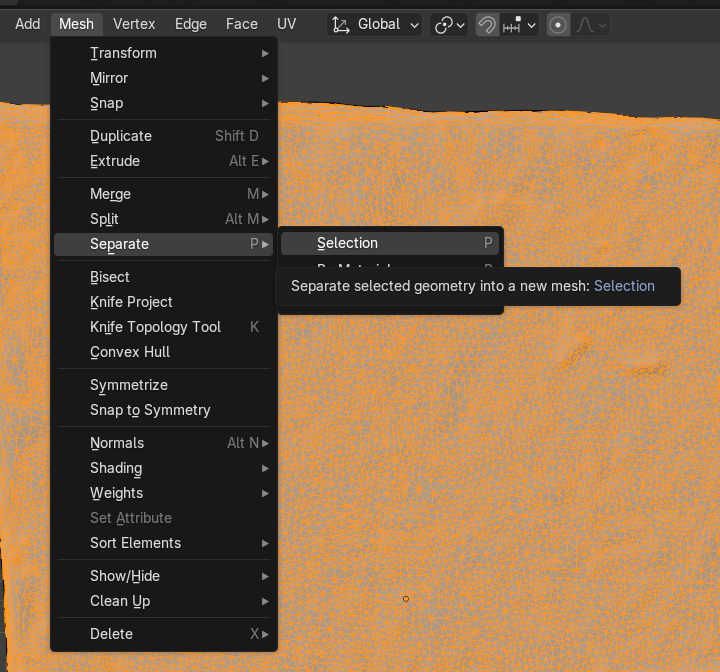

**IMPORTANT:** The panel is now its own object, but you are still editing the original model! Before moving on:

- Press Tab to go back to Object Mode
- Click on the new panel object to select it
- Press Tab again to go into Edit Mode on the panel

**Step 4.4 - Creating a New UV Map**

_Why? We need to create a new UV map because when we add a new texture, it will be aligned to the 'old map' from when it was the full 3D model. Since we are separating it into panels, we need to make sure the new UV map will fully map (fill) onto the new texture._

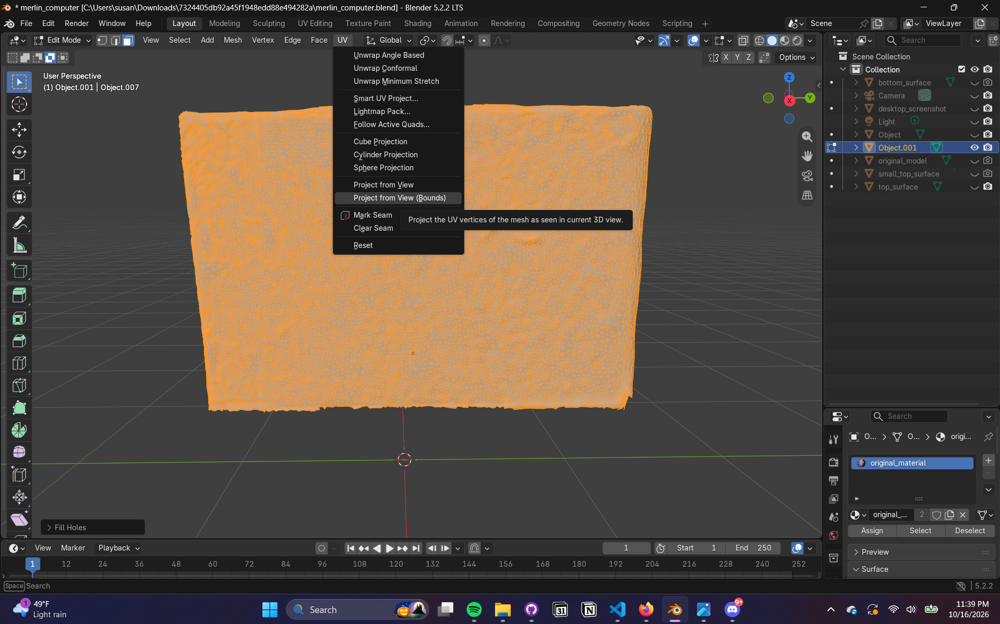

- Select All (A)
- UV -> Project from View (Bounds)
  - Make sure that you are viewing it straight on (+ FLAT)
  - _Tip: use the numpad to snap your view! 7 = top, 1 = front, 3 = side (Ctrl + the number views it from the opposite side)_
  - _What you are viewing is exactly how the UV map is going to look_

**Step 4.5 - Scan -> New Material Surface**

_Why? So each surface + scan has its own assigned material texture, separate from the Polycam 3D scan texture. Do not overwrite the original texture, just add a new one. We will use the OG Polycam 3D scan texture to fill in gaps that could not be scanned with the flatbed scanner._

- Make sure you are in Edit Mode (on the panel object!)
- Make sure the Select Mode is on FACES
- Select ALL (A)
- In the Properties editor (right side), open the Material Properties tab (the red sphere icon)
  - Click the + to add a new material slot
  - Click "New" to create a material in that slot (NAME IT)
  - Hit Assign (make sure all of the mesh is selected)

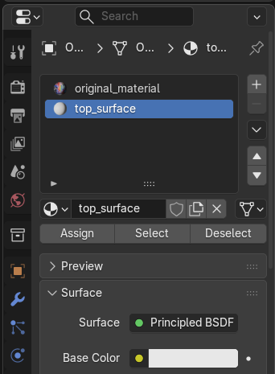

**Step 4.6 - Adding a New Image Texture -> New Material Surface**

_Why? So you can import the flatbed scan as a texture for the material._

- Make sure your flatbed scan is cropped + in the correct orientation (from Step 2)
- In the same section, scroll down to Base Color -> click the small dot next to it -> Image Texture -> Open -> pick your scan
- Switch the viewport to Material Preview (press Z -> Material Preview) so you can actually see the texture!

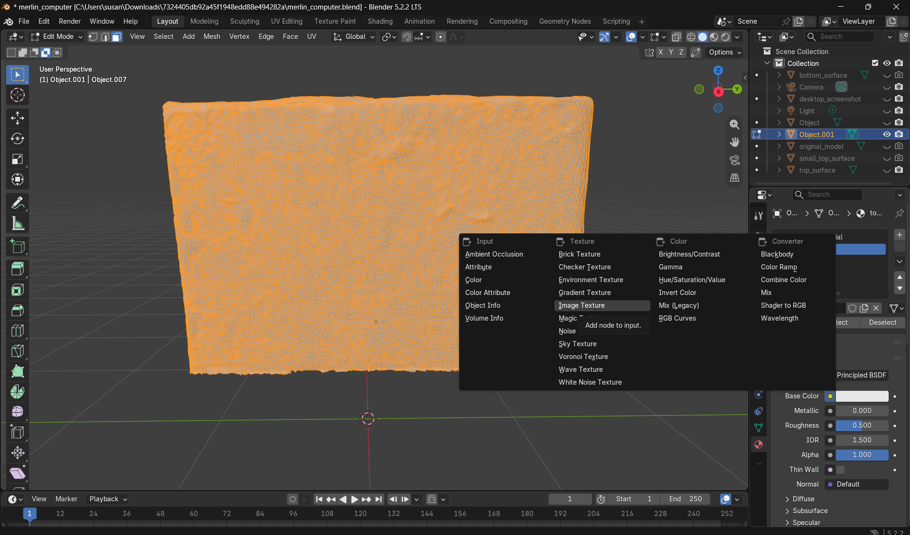

Result!

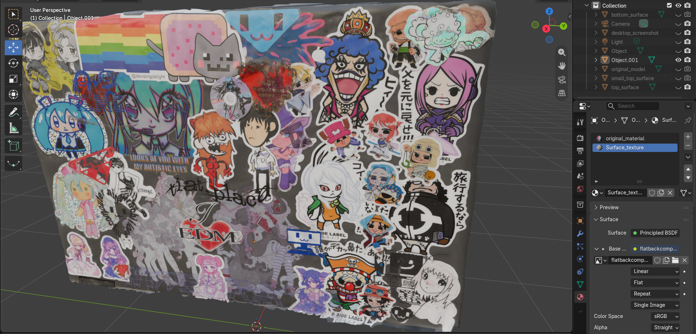

**Step 4.7 - Repeat!**

- Repeat Steps 4.3–4.6 for each of the other surfaces!

**Step 4.8 - Pack Your Textures**

_Why? So your .blend file keeps the scan images inside it. Otherwise the textures can go missing when the file is opened on another computer!_

- File -> External Data -> Pack Resources
- Save your .blend file

**Step 4.9 - EXPORT**

- File -> Export -> glTF 2.0 (.glb/.gltf)!

## Please Submit via the [Computer Archive Submission Form](https://forms.gle/5aMCwi9YGYJsrawSA)!

**ZIP FILE SHOULD INCLUDE:**

- {name}\_computer.glb/gltf
- {name}\_computer.blend
- textures_UPDATED (FOLDER)
- textures_POLYCAM (FOLDER)
- flatbedScans_EXPORT (FOLDER)

## Please fill out the [feedback form](https://forms.gle/EAfnr9bHLjHhQQ3q8) so I can improve/fix any issues in the tutorial!

_thanks so much for being part of the archive <3_

_made with love, merlin_
